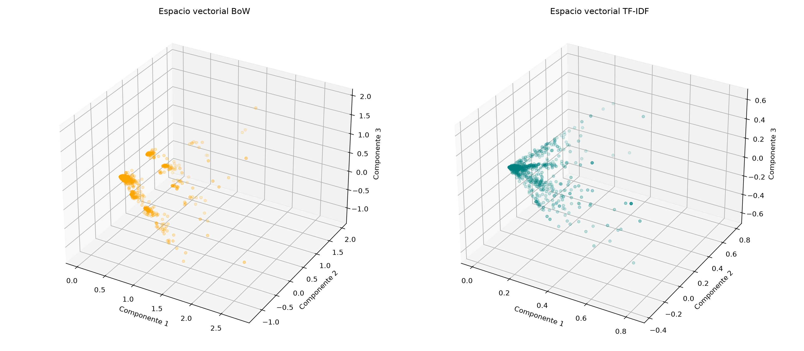

# Checkpoint 2 - Procesamiento de Lenguaje Natural

## Descripción

Proyecto de análisis de sentimientos desarrollado en Python utilizando técnicas de Procesamiento de Lenguaje Natural (PLN).

El sistema clasifica reseñas de restaurantes como positivas o negativas mediante un modelo de aprendizaje automático.

Como continuación del Checkpoint 2, se implementaron y compararon dos técnicas de representación vectorial: Bag-of-Words (BoW) y TF-IDF.

## Tecnologías utilizadas

- Python
- spaCy
- pandas
- scikit-learn
- NumPy
- Matplotlib
- FastAPI
- Joblib

## Dataset

Se utilizó el archivo `Restaurant_Reviews.tsv`, compuesto por 1,000 reseñas de restaurantes etiquetadas según su sentimiento.

## Preprocesamiento

Se implementó un proceso de normalización mediante spaCy que incluye:

1. Tokenización.
2. Eliminación de palabras vacías (stop words).
3. Eliminación de puntuación y espacios.
4. Lematización.
5. Conversión a minúsculas.

## Clasificación de sentimientos

Se desarrolló un pipeline de aprendizaje automático utilizando:

- TF-IDF para la representación numérica del texto.
- Multinomial Naive Bayes para la clasificación.

El modelo obtuvo una precisión aproximada del 76 % durante la evaluación inicial.

El modelo entrenado se almacena en `pipeline.pkl`.

## Vectorización de texto

Se implementaron dos técnicas de extracción de características.

### Bag-of-Words

Utiliza `CountVectorizer` para representar cada documento mediante la frecuencia de aparición de sus palabras.

### TF-IDF

Utiliza `TfidfVectorizer` para calcular la relevancia relativa de cada término dentro de la colección de documentos.

### Resultados

| Métrica                   | BoW         | TF-IDF      |
| ------------------------- | ----------- | ----------- |
| Documentos procesados     | 993         | 993         |
| Tamaño del vocabulario    | 1,553       | 1,553       |
| Dimensiones               | 993 x 1,553 | 993 x 1,553 |
| Valores distintos de cero | 4,676       | 4,676       |

Siete reseñas quedaron vacías después del preprocesamiento y fueron excluidas de la vectorización.

### Reducción de dimensionalidad

Se utilizó `TruncatedSVD` para reducir las matrices vectoriales a tres dimensiones y visualizar la distribución de las reseñas.



## Ejecución

Instalar las dependencias:

```bash
python -m pip install -r requirements.txt
```

Instalar el modelo de spaCy:

```bash
python -m spacy download en_core_web_sm
```

Ejecutar el entrenamiento:

```bash
python entrenamiento.py
```

Ejecutar la vectorización:

```bash
python vectorizacion.py
```

Ejecutar la API:

```bash
uvicorn app:app --reload
```

## Archivos principales

- `preprocesamiento.py`: limpieza y lematización del texto.
- `entrenamiento.py`: entrenamiento y evaluación del clasificador.
- `vectorizacion.py`: implementación y comparación de BoW y TF-IDF.
- `app.py`: API para realizar predicciones.
- `pipeline.pkl`: modelo entrenado.
- `comparacion_vectorizacion.png`: visualización tridimensional.
- `requirements.txt`: dependencias del proyecto.

## Conclusión

La implementación permitió comprender cómo transformar texto no estructurado en representaciones numéricas.

Bag-of-Words representa las frecuencias de las palabras, mientras que TF-IDF pondera su importancia relativa dentro del corpus.

La reducción de dimensionalidad permitió visualizar las diferencias entre ambas representaciones y comprender su aplicación en tareas de Procesamiento de Lenguaje Natural.
